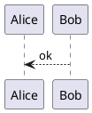

# Send order confirmations by email

<!-- A hint from the template,
     over two lines. -->

## Goals

- Send a confirmation email when an order is placed,
  wrapped onto a second line
- Keep the **existing** on-screen confirmation
  1. first nested, *ordered*
  2. second nested with `code_span` and a [link](https://example.com/a_b-c)

## Design

As agreed with @jdoe, see  and the [spec](attachments/spec.pdf).
Escapes: \*not bold\*, a {brace}, a [bracket], a pipe |, C:\path, -5 and 3-D, SOME_CONST_NAME, foo**bar**baz.
Hi! See <https://example.com/x_y> and https://example.com/raw_url-x. Mail <me@example.com>.

> [!WARNING]
> Mind the **queue**.

> A plain quote
> on two lines.

```java
record OrderPlaced(String id) {} // {code} *not bold*
```

```
plain text
```



    indented code

| Field | Required |
| --- | :---: |
| `id` | yes \| always |
| name | line one<br>line two |

---

h1. not a heading
\* not a list
~~gone~~ and _em_ and __strong__.

- [x] Design reviewed
- [ ] Load test with <tags> & "quotes"

1. item with code
   ```bash
   mvn verify ]]> done
   ```
2. item two
