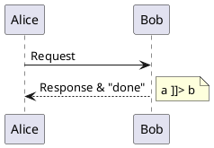

# PlantUML

https://confluence.example.com/spaces/PAY/pages/77/PlantUML
Space: PAY · Version: 3

Flow:



- in a list
  ```plantuml
  @startuml
    A -> B
  @enduml
  ```

| diagram |
| --- |
| @startuml<br>A \| B<br>@enduml |


